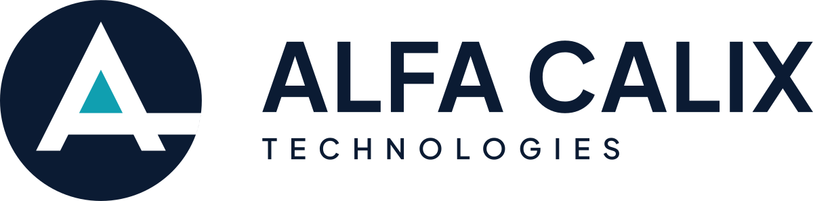
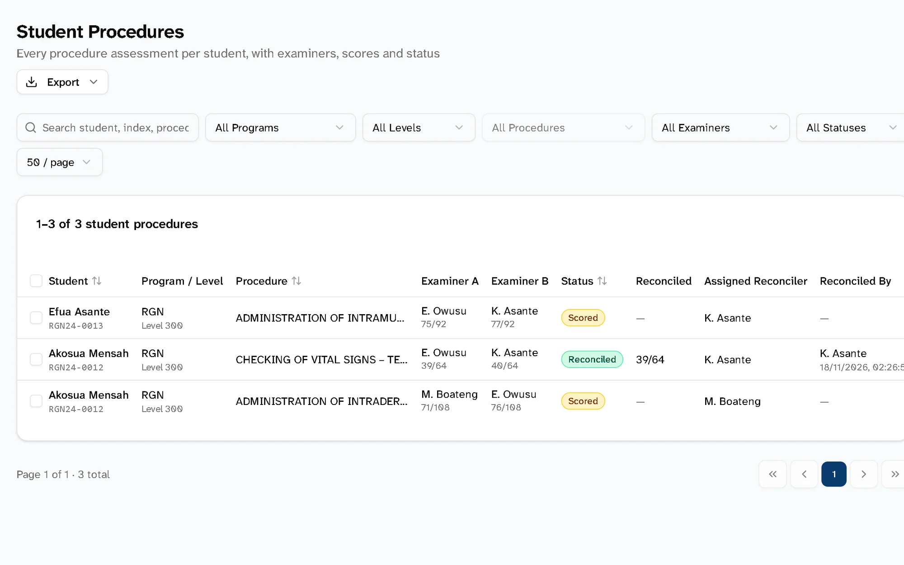
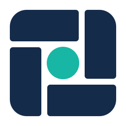
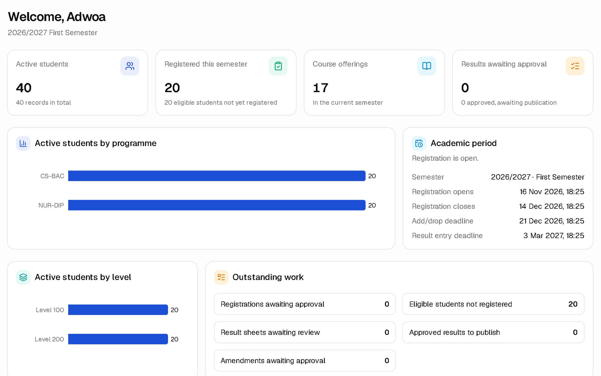
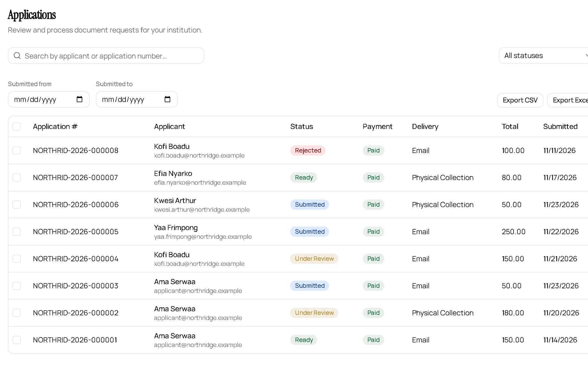

  <picture>
    <source media="(prefers-color-scheme: dark)" srcset="brand/logo/png/alfa-calix-horizontal-dark-1200.png">
    
  </picture>

<h3 align="center">Building Intelligent Software. Empowering Institutions.</h3>

  Practical software products and technology solutions that help institutions and businesses 
  simplify operations, improve efficiency and embrace digital transformation.

  <a href="#get-in-touch"><strong>Start a conversation</strong></a> &nbsp;·&nbsp;
  <a href="#our-products"><strong>Explore our products</strong></a> &nbsp;·&nbsp;
  <a href="#our-services"><strong>See our services</strong></a>

---

## Who we are

Alfa Calix Technologies is a software development and technology solutions company in Ghana. We build our own
software products for institutions, and we design and develop tailored digital solutions for organisations whose
needs off-the-shelf tools don't meet.

Our focus is simple: **technology that solves real problems.** We start by understanding how your organisation
actually works, then build software that makes everyday processes simpler, faster and easier to manage, and we stay
with you after launch.

**We work with:** universities, colleges and tertiary institutions · nursing and midwifery training institutions ·
schools and educational organisations · businesses · public and private institutions.

---

## Our products

Purpose-built software, already designed around the way institutions work. Each product can be demonstrated to your
team with sample data.

 

###  ClinOva: clinical assessment and examination management

**Clinical practical examinations, organised end to end.** ClinOva replaces paper score sheets with a digital workflow
built for nursing and midwifery training institutions: examiners score each procedure step on a phone or tablet, two
examiners can assess the same candidate, and their scores are reconciled in the system.

- Digital clinical practical assessments
- Structured examiner scoring, with support for multiple examiners
- Score reconciliation between examiners
- Centralised assessment records for coordinators

**Designed for:** nursing and midwifery training institutions, examination coordinators, clinical examiners and
academic administrators.

**[Visit the ClinOva website](https://clinovasite.vercel.app)** or [ask us for a demo](#get-in-touch).

 

###  SIS: Student Information System

**One place for student records, registration and results.** SIS brings an institution's core academic administration
into a single platform, with dedicated portals for students, lecturers and administrators.

- Student records management
- Online course registration
- Academic results management
- Student and lecturer portals, with administrative dashboards

**Designed for:** universities, colleges and tertiary institutions, registry and academic affairs offices,
lecturers and heads of department, and students.

**[Request an SIS demo](#get-in-touch)**

 

###  DRS: Document Request System

**Academic document requests, without the queue.** DRS lets students and alumni request transcripts, certificates
and other academic documents online, from anywhere, while registry staff manage, track and process every request
in one place.

- Online document requests and remote application submission
- Integrated payment for requested documents
- Request tracking and processing for registry staff
- Convenient access for students and alumni

**Designed for:** universities, colleges and training institutions, registry and records offices, current students
and alumni.

**[Request a DRS demo](#get-in-touch)**

Screens show sample data.

---

## Our services

Beyond our own products, we help organisations identify opportunities, solve operational challenges and build
effective digital systems.

| Service | What we do |
| --- | --- |
| **Custom Software Development** | Tailored applications built around your organisation's own processes, with a focus on usability, scalability and long-term value. |
| **Web Application Development** | Modern, responsive and secure web applications that bring services online, automate processes and improve access. |
| **Institutional Systems Development** | Platforms for academic administration, student information management and other specialised institutional processes. |
| **Website Design and Development** | Professional, responsive websites that strengthen your identity and help people find you online. |
| **Systems Integration and Process Automation** | Connecting the systems you already use and automating repetitive work, so information flows without re-entry. |
| **Software Maintenance and Technical Support** | Ongoing support, fixes, updates and improvements that keep your software reliable as your needs change. |

**Is one of these what you need?** [Tell us about your project](#get-in-touch).

---

## Why Alfa Calix Technologies

- **We start with your problem, not with technology.** We learn how your organisation works before we design
  anything, so the solution fits real needs.
- **Purpose-built, not one-size-fits-all.** Our products and projects are shaped around specific operational
  requirements and the people who use them.
- **Designed for the people who use it.** Simple, accessible software that staff, students and clients can use
  without a manual.
- **We stay after launch.** Software should improve as your needs change. We provide ongoing support and continuous
  improvement.

## How we work

| 1. Understand | 2. Design | 3. Develop | 4. Support |
| --- | --- | --- | --- |
| We learn about your organisation, its needs and the challenges you want to solve. | We shape the right solution and define exactly what it needs to do. | We build, test and refine it with attention to quality and usability. | We provide ongoing technical support and improvements where required. |

---

## Get in touch

**Ready to see how technology can help your organisation?** Whether you're interested in ClinOva, SIS or DRS, or
need a custom platform, website or integration, we would be glad to learn about your requirements and talk through
the options.

Tell us about:

- **A product demo:** which product, and roughly how many students, staff or users it would serve
- **A custom project:** what you want to improve, and any systems you already use
- **A partnership:** who you are and what you have in mind

<!--
  CONTACT DETAILS: replace the three lines below with the real website address, email and phone/WhatsApp
  before this README is shared. Delete any line you don't want to publish.
-->
- **Website:** `alfacalix.vercel.app`
- **Email:** `adjeikumicaleb@gmail.com`
- **Phone / WhatsApp:** `233555089184`

---

  
    © 2026 Alfa Calix Technologies. All rights reserved. 
    Alfa Calix Technologies is a technology brand operated by Alfa Calix Enterprise. 
    This repository contains the company website. Team members: see the <a href="docs/DEVELOPMENT.md">developer guide</a>.
  

